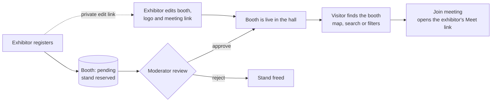

<div align="center">


<br />

**A lightweight, mobile-first directory of virtual expo booths.**
Exhibitors get a shareable booth page. Visitors browse a hall map and join a meeting in one tap, no account needed.

<br />

[](https://github.com/prohound/virtual-expo-mvp/actions/workflows/ci.yml)
[](https://github.com/prohound/virtual-expo-mvp/actions/workflows/deploy.yml)
[](LICENSE)
[](CONTRIBUTING.md)
[](https://github.com/prohound/virtual-expo-mvp/commits/main)
[](https://github.com/prohound/virtual-expo-mvp/issues)
[](https://github.com/prohound/virtual-expo-mvp/stargazers)

[](https://www.typescriptlang.org/)
[](https://react.dev/)
[](https://vite.dev/)
[](https://tailwindcss.com/)
[](https://hono.dev/)
[](https://developers.cloudflare.com/workers/)
[](https://zod.dev/)
[](https://pnpm.io/)
[](https://nodejs.org/)

[Live site](https://wetexpo.prohound.io) ·
[Quickstart](#quickstart) ·
[Architecture](#architecture) ·
[API](#api-reference) ·
[Contributing](#contributing) ·
[License](#license)

</div>

> **Independent initiative.** This project is not affiliated with, endorsed by, or sponsored by any event organizer. It does not use any third party's branding, maps or data. See the [ground rules](CONTRIBUTING.md#ground-rules-please-read).

---

## Table of contents

- [About](#about)
- [Features](#features)
- [How it works](#how-it-works)
- [Tech stack](#tech-stack)
- [Quickstart](#quickstart)
- [Configuration](#configuration)
- [Scripts](#scripts)
- [Architecture](#architecture)
- [The hall and its stands](#the-hall-and-its-stands)
- [API reference](#api-reference)
- [Deployment](#deployment)
- [Security and privacy](#security-and-privacy)
- [Documentation](#documentation)
- [Roadmap](#roadmap)
- [Contributing](#contributing)
- [License](#license)
- [Acknowledgements](#acknowledgements)

---

## About

When an in-person expo is disrupted, exhibitors and visitors still need a low-friction way to find each other and start a conversation. WetExpo is a small, independent directory that does exactly that and nothing more:

- an exhibitor registers a company, writes a short pitch and shares a meeting link they host themselves (Google Meet);
- a moderator reviews the listing and publishes it;
- visitors discover booths through search, filters or a visual hall map and open the meeting from their phone.

The app **never relays audio or video**. The meeting link is an outbound link, not a backend dependency, which keeps the product simple, cheap to run and easy to reason about.

## Features

**For visitors**

- Responsive hall map with one detailed floor plan per pavilion; every stand is drawn, occupied stands light up by tier, and tapping a stand opens a quick-look panel.
- Directory with a search bar and a filters panel (category, pavilion, tier) with themed, keyboard-accessible dropdowns.
- Booth cards with logo, tier badge, pavilion and category.
- Booth detail page with banner, logo, pitch, website, a copy-link button and a one-tap **Join meeting** button.
- No account, no sign-in, no tracking of visitors.

**For exhibitors**

- Self-service registration with stand selection from the live floor plan (taken stands are disabled).
- Company logo or photo upload, resized in the browser before it is sent.
- A private edit link (capability token) to check the moderation status, edit the booth and refresh the meeting link.
- Guidance for the Google Meet 1-hour limit on accounts without Google Workspace: swap in a fresh link at any time from a dedicated card on the edit page.
- A "My booth" shortcut that remembers the edit link on the same device.

**For moderators**

- Review queue with approve, reject, hide and stand placement.
- Pending submissions already reserve their stand, so nobody can squat or double-book a slot.

**Platform**

- One deployable unit on Cloudflare Workers (React SPA plus JSON API) with D1 for storage.
- Anti-abuse: Turnstile verification and a per-IP rate limit on submissions.
- CI on every pull request and automatic production deploy on every push to `main`.

## How it works



## Tech stack

| Layer | Technology |
| --- | --- |
| Frontend | React 18, React Router 6, TypeScript 5, Tailwind CSS 4, Vite 6 |
| API | Hono 4 on Cloudflare Workers, Zod 3 for input validation |
| Storage | Cloudflare D1 (SQLite), plain SQL migrations |
| Anti-abuse | Cloudflare Turnstile, Workers rate limiting |
| Tooling | pnpm 10, Wrangler 4, GitHub Actions |

## Quickstart

**Requirements:** Node.js **22.12 or newer** (Wrangler 4 refuses to start on older versions) and [pnpm](https://pnpm.io) 10.

```bash
git clone https://github.com/prohound/virtual-expo-mvp.git
cd virtual-expo-mvp

pnpm install                     # install dependencies
cp .dev.vars.example .dev.vars   # local secrets (moderator token, optional Turnstile)
pnpm db:setup                    # create local D1 tables and load example booths
pnpm dev                         # http://localhost:5173
```

Open <http://localhost:5173>. The home page shows the hall map and the directory, seeded with example booths. The moderator area lives at `/admin`; the token is the `ADMIN_TOKEN` value in your `.dev.vars`.

<details>
<summary><strong>Troubleshooting</strong></summary>

- **`Wrangler requires at least Node.js v22.12.0`**: switch Node versions (`nvm use 22`) and run the command again.
- **The page does not load after switching branches or pulling**: stop the dev server, run `pnpm install` and `pnpm db:setup`, then start `pnpm dev` again. New migrations only apply when you re-run `db:setup`.
- **Cannot reach `localhost`**: use `http://127.0.0.1:5173` instead.
- **Moderator area answers 503**: `ADMIN_TOKEN` is not set in `.dev.vars`.

</details>

## Configuration

Local values live in `.dev.vars` (git-ignored). Copy `.dev.vars.example` to get started.

| Name | Kind | Required | Purpose |
| --- | --- | --- | --- |
| `ADMIN_TOKEN` | secret | yes, for `/admin` | Shared secret that protects the moderator endpoints. Without it they return `503`. |
| `TURNSTILE_SECRET` | secret | recommended in production | Server-side Turnstile key. When unset, the anti-bot check is skipped (local dev). |
| `TURNSTILE_SITE_KEY` | public var | optional | Public site key; when set the widget renders on the registration form. Set in `wrangler.jsonc`. |
| `SUBMIT_LIMITER` | binding | provided | Per-IP rate limit for public submissions (5 per minute). Defined in `wrangler.jsonc`. |

Never commit secrets. `.dev.vars`, `.env*` and `.wrangler/` are git-ignored; keep it that way.

## Scripts

| Script | What it does |
| --- | --- |
| `pnpm dev` | Vite dev server with the Worker and local D1 (hot reload) |
| `pnpm build` | Production build (client and Worker) |
| `pnpm preview` | Serve the production build locally |
| `pnpm typecheck` | TypeScript check across app and Worker |
| `pnpm db:setup` | Apply migrations **and** seed the local database |
| `pnpm db:migrate:local` / `pnpm db:migrate:remote` | Apply migrations locally / to the remote database |
| `pnpm db:seed:local` / `pnpm db:seed:remote` | Load `seed.sql` |
| `pnpm db:create` | Create the remote D1 database (run once) |
| `pnpm deploy` | Build and deploy to Cloudflare |
| `pnpm cf-typegen` | Regenerate Worker binding types |

## Architecture

```text
index.html                  SPA entry
src/                        React SPA
  main.tsx                  router: /, /booths/:slug, /register, /edit/:id, /admin
  pages/                    Home, BoothDetail, Register, EditBooth, Admin, NotFound
  components/               Layout, BoothCard, HallMap, Select, LogoPicker, Turnstile
  lib/                      API client, shared types, image processing, local helpers
shared/
  stands.ts                 floor plan: pavilions, stands, tiers (used by client and Worker)
worker/                     Cloudflare Worker (Hono): the JSON API under /api/*
  index.ts                  routes and handlers
  lib/                      validation (zod), tokens, slugs, image sniffing, Turnstile
migrations/                 D1 schema, applied in order
seed.sql                    example booths for local development
wrangler.jsonc              Worker config: D1, rate limit, routing, custom domain
docs/                       product brief, scope, data model, decisions, delivery plan
.github/                    CI, deploy workflow, issue and PR templates
```

The Worker handles `/api/*`; everything else is served as the React SPA (`not_found_handling: single-page-application`). Architectural decisions are recorded under [`docs/adr`](docs/adr).

## The hall and its stands

The floor plan is defined once in [`shared/stands.ts`](shared/stands.ts) and used by the map, the registration form and the Worker, so the server is the source of truth for which stand belongs to which pavilion and tier.

| Pavilion | Stands | Tiers |
| --- | --- | --- |
| Pavilhão 1 | 140 | Alpha 140 |
| Pavilhão 2 | 230 | Alpha 150, Beta 80 |
| Pavilhão 3 | 230 | Alpha 170, Growth 60 |
| Pavilhão 4 | 280 | Alpha 200, Beta 80 |

880 stands in total. Stand codes look like `P3-100` (pavilion prefix plus a three-digit number). The layout is original to this project and intentionally does not copy any other event's map.

## API reference

All responses are JSON. Public responses never include `owner_email` or the edit token hash.

| Method | Path | Access | Description |
| --- | --- | --- | --- |
| `GET` | `/api/booths?q=&category=&zone=` | Public | Approved booths, with optional search and filters |
| `GET` | `/api/booths/:slug` | Public | One approved booth |
| `GET` | `/api/stands` | Public | Stand codes already taken (codes only) |
| `GET` | `/api/config` | Public | Public client config (Turnstile site key) |
| `POST` | `/api/booths` | Public, rate limited | Create a `pending` submission; returns the edit link once |
| `GET` | `/api/booths/:id/manage` | Owner (`x-edit-token`) | Owner view of the booth in any status |
| `PATCH` | `/api/booths/:id` | Owner (`x-edit-token`) | Edit booth fields |
| `GET` | `/api/booths/:id/logo` | Public once approved; owner or moderator before | Serve the uploaded logo |
| `PUT` | `/api/booths/:id/logo` | Owner (`x-edit-token`) | Upload or replace the logo (PNG, JPEG or WebP, max 512 KB) |
| `DELETE` | `/api/booths/:id/logo` | Owner (`x-edit-token`) | Remove the logo |
| `GET` | `/api/admin/booths?status=` | Moderator (`x-admin-token`) | Review queue |
| `PATCH` | `/api/admin/booths/:id` | Moderator (`x-admin-token`) | Approve, reject, hide, or assign a stand |

## Deployment

The project deploys as a single Cloudflare Worker with static assets and a D1 database.

### Continuous deployment

Every push to `main` runs the **Deploy** workflow: type check, build, apply remote D1 migrations, then `wrangler deploy`. Pull requests run **CI** (type check and build). The workflow needs two repository secrets:

- `CLOUDFLARE_API_TOKEN`
- `CLOUDFLARE_ACCOUNT_ID`

### Manual deployment

1. **Create the database** and copy the returned `database_id` into `wrangler.jsonc`:
   ```bash
   pnpm db:create
   ```
2. **Apply the schema** to the remote database:
   ```bash
   pnpm db:migrate:remote
   ```
3. **Set secrets** (never commit these):
   ```bash
   npx wrangler secret put ADMIN_TOKEN
   npx wrangler secret put TURNSTILE_SECRET
   ```
4. **Deploy:**
   ```bash
   pnpm deploy
   ```

The first deploy ships to a free `*.workers.dev` subdomain. A custom domain can be added in `wrangler.jsonc` under `routes`.

## Security and privacy

- **Moderation first.** Submissions are `pending` by default; nothing is public until a moderator approves it.
- **Capability tokens.** Edit links carry 32 random bytes, stored only as a SHA-256 digest and shown to the owner once. The token sits in the URL fragment (`#token=...`), so it stays out of server logs and referrers. Comparison is constant time.
- **Validated input.** Every request body is validated with Zod on the Worker; all D1 statements are parameterized; user text is rendered as plain text, never as HTML.
- **Safe links.** Submitted URLs must be `https`; the meeting link must be a Google Meet URL.
- **Safe uploads.** Logos are accepted only as PNG, JPEG or WebP, identified by their magic bytes (never by the client's `Content-Type`). SVG and GIF are rejected because SVG can carry script. Images are served with `nosniff` and a sandboxing CSP.
- **Anti-abuse.** Turnstile verification plus a per-IP rate limit on submissions.
- **No visitor data.** Browsing needs no account and collects no visitor email.
- **Moderator auth is a shared secret.** `ADMIN_TOKEN` is intentionally simple for the MVP; replace it with real authentication before adding more moderators.

Found a vulnerability? Please report it **privately** to the maintainers rather than opening a public issue. See [`docs/SECURITY-LEGAL.md`](docs/SECURITY-LEGAL.md) for security, privacy and legal notes.

## Documentation

| Document | What is inside |
| --- | --- |
| [`docs/PRODUCT.md`](docs/PRODUCT.md) | Problem, goal, audience and core experience |
| [`docs/MVP-SCOPE.md`](docs/MVP-SCOPE.md) | What is in and out of the MVP |
| [`docs/ARCHITECTURE.md`](docs/ARCHITECTURE.md) | System design |
| [`docs/DATA-MODEL.md`](docs/DATA-MODEL.md) | Tables, columns and constraints |
| [`docs/DECISIONS.md`](docs/DECISIONS.md) and [`docs/adr`](docs/adr) | Decision log and architecture decision records |
| [`docs/SECURITY-LEGAL.md`](docs/SECURITY-LEGAL.md) | Security, privacy and legal notes |
| [`docs/DELIVERY-PLAN.md`](docs/DELIVERY-PLAN.md) | Delivery plan and next steps |
| [`docs/BACKLOG.md`](docs/BACKLOG.md) | Proposed issue backlog |

## Roadmap

The project is an MVP with a complete end-to-end flow: discover and join, submit, moderate, publish, edit. Ideas under consideration (see the [backlog](docs/BACKLOG.md) for detail):

- [x] Original hall map with per-pavilion plans
- [x] Search, filters and shareable booth pages
- [x] Anti-abuse: Turnstile and rate limiting
- [x] Logo upload for exhibitors
- [ ] Verified edit-link recovery (email delivery or moderator-issued links)
- [ ] Moderator click-to-place booth positions
- [ ] Availability state with expiry, so a booth shows as active only while the exhibitor is present
- [ ] Privacy-reviewed aggregate counters (booth opens and outbound joins)
- [ ] Real authentication for moderators
- [ ] Rollback, backup and retention policies

Have an idea? [Open a feature request](https://github.com/prohound/virtual-expo-mvp/issues/new/choose).

## Contributing

Contributions of all sizes are welcome. The short version:

1. Open an issue first for anything non-trivial so we can agree on the approach.
2. Fork the repository and create a branch (`feat/...` or `fix/...`).
3. Keep each pull request focused on one logical change.
4. Make sure `pnpm typecheck` and `pnpm build` pass; CI runs them on every pull request.
5. Fill in the pull request template and describe how you tested the change.

Please read [`CONTRIBUTING.md`](CONTRIBUTING.md) for code style and the **ground rules**: no third-party logos, trademarks, official maps or visual identity, no real people's or companies' data without permission, and no publishing without moderation.

By contributing you agree that your contributions are licensed under the project's MIT License.

## License

This project is released under the **MIT License**. The full text is in [`LICENSE`](LICENSE).

> Copyright (c) 2026 Isaque Sena

In plain terms, here is what the MIT License means for you. This summary is informational; the [`LICENSE`](LICENSE) file is the authoritative text.

| You may | You must | You get |
| --- | --- | --- |
| Use it commercially | Keep the copyright notice and the MIT permission notice in all copies or substantial portions of the software | The software **as is**, with no warranty of any kind, express or implied (including merchantability, fitness for a particular purpose and non-infringement) |
| Modify it | | No liability: the authors and copyright holders are not liable for any claim, damages or other liability arising from the software or its use |
| Distribute it | | |
| Sublicense it | | |
| Use it privately | | |

Things the license does not do: it does not grant rights to anyone else's trademarks or branding, and it does not make the project an official product of any event or organizer. Third-party names such as Cloudflare, Google Meet and the libraries listed below belong to their respective owners.

## Acknowledgements

Built on the shoulders of [Cloudflare Workers and D1](https://developers.cloudflare.com/), [Hono](https://hono.dev/), [React](https://react.dev/), [Vite](https://vite.dev/), [Tailwind CSS](https://tailwindcss.com/), [Zod](https://zod.dev/) and [pnpm](https://pnpm.io/). Badges by [Shields.io](https://shields.io/).

<div align="center">
<sub>Made for exhibitors and visitors who still want to meet.</sub>
</div>
