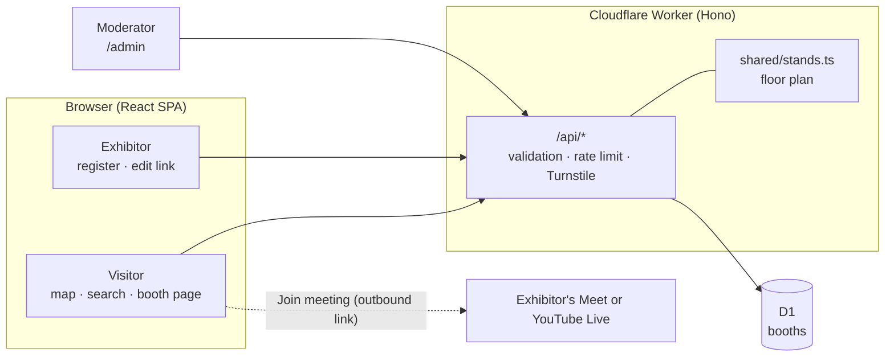
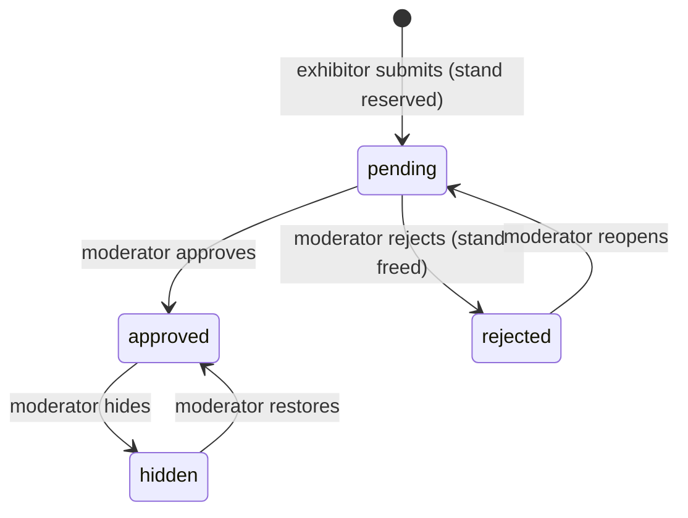

<div align="center">



<br>

[](https://developers.cloudflare.com/workers/)
[](https://react.dev/)
[](https://www.typescriptlang.org/)
[](https://tailwindcss.com/)

[](https://github.com/prohound/virtual-expo-mvp/actions/workflows/ci.yml)
[](https://github.com/prohound/virtual-expo-mvp/actions/workflows/deploy.yml)


[](LICENSE)

[](CONTRIBUTING.md)

**A mobile-first directory of virtual expo booths.** Exhibitors get a shareable page, visitors find them on a hall map and join the meeting.

[Features](#features) · [Quickstart](#quickstart) · [Usage](#usage) · [How it works](#how-it-works) · [API](#api-reference) · [Deploy](#deployment) · [Security](#security-and-privacy) · [Development](#development) · [License](#license)

[**wetexpo.prohound.io**](https://wetexpo.prohound.io)

</div>

---

> [!NOTE]
> Independent initiative. WetExpo is **not affiliated with, endorsed by, or sponsored by any event organizer**, and it does not use any third party's branding, maps or data. It also never relays audio or video: the meeting link is an outbound link to a call the exhibitor hosts. See the [ground rules](CONTRIBUTING.md#ground-rules-please-read).

## Why this exists

When an in-person expo is disrupted, exhibitors and visitors still need an easy way to find one another and start a conversation. WetExpo does that and nothing more: an exhibitor registers a company and shares a Google Meet or YouTube Live link, a moderator reviews it, and visitors discover the booth through search, filters or a visual hall map, then join from their phone. No visitor accounts, no installs.

## Features

<table>
<tr>
<td width="33%" valign="top">

### Hall map
One detailed floor plan per pavilion with **every stand drawn**. Occupied stands light up in their tier color; tap one for a quick-look panel with a link to the booth.

</td>
<td width="33%" valign="top">

### Search and filters
A search bar plus a filters panel (category, pavilion, tier) with themed, keyboard-accessible dropdowns and **Apply / Clear**. The map follows the same filters.

</td>
<td width="33%" valign="top">

### Booth pages
Banner, logo, pitch, website, a copy-link button and a one-tap **Join meeting**. Every booth has its own shareable URL.

</td>
</tr>
<tr>
<td valign="top">

### Self-service registration
Pick an available stand straight from the floor plan (taken stands are disabled), describe the company and submit. Nothing goes public before review.

</td>
<td valign="top">

### Logo upload
Exhibitors upload their company photo; it is resized in the browser, validated on the server and shown on the booth card and detail page.

</td>
<td valign="top">

### Private edit link
A capability link lets owners check the moderation status and edit the booth at any time. A **My booth** shortcut remembers it on the same device.

</td>
</tr>
<tr>
<td valign="top">

### Meeting link refresh
Google Meet links from accounts without Workspace end after **1 hour**. A dedicated card on the edit page swaps in a fresh link in one step; YouTube Live booths can replace their stream URL there as well.

</td>
<td valign="top">

### Moderation
A review queue to approve, reject, hide and place booths. Pending submissions already reserve their stand, so nobody can squat or double-book a slot.

</td>
<td valign="top">

### Built to be abuse-resistant
Turnstile on the form, a per-IP rate limit, strict input validation, https-only links and provider-specific allowlists for Google Meet and YouTube Live URLs.

</td>
</tr>
</table>

### Who it is for

| Role | What they do | Needs an account? |
| --- | --- | :---: |
| **Visitor** | Browse the hall, search, filter, open a booth, join the meeting | No |
| **Exhibitor** | Register a booth, upload a logo, edit it and refresh the meeting link | No (private edit link) |
| **Moderator** | Review submissions, approve, reject, hide, place booths | Shared admin token |

### What is live and what is next

| Area | Status | Notes |
| --- | :---: | --- |
| Hall map, directory, booth pages | Live | Original layout, 880 stands in 4 pavilions |
| Registration, moderation, owner editing | Live | Pending by default; edit link shown once |
| Logo upload | Live | Browser accepts PNG, JPEG, WebP, GIF, AVIF or BMP up to 25 MB; Worker accepts PNG, JPEG or WebP up to 512 KB |
| Anti-abuse (Turnstile, rate limit) | Live | Per-IP, 5 submissions per minute |
| Verified edit-link recovery | Planned | Email delivery or moderator-issued links |
| Click-to-place booth positions | Planned | Moderator tool |
| Availability state with expiry | Planned | Show a booth as active only while the exhibitor is present |
| Real moderator authentication | Planned | Replaces the shared admin token |
| Privacy-reviewed aggregate counters | Planned | Booth opens and outbound joins only |

## Quickstart

> [!IMPORTANT]
> Requires **Node.js 22.12 or newer** (Wrangler 4 will not start on older versions) and [pnpm](https://pnpm.io) 10.

```bash
git clone https://github.com/prohound/virtual-expo-mvp.git
cd virtual-expo-mvp

pnpm install                     # install dependencies
cp .dev.vars.example .dev.vars   # local secrets (moderator token, optional Turnstile)
pnpm db:setup                    # create local D1 tables and load example booths
pnpm dev                         # http://localhost:5173
```

Open <http://localhost:5173>. The home page shows the hall map and the directory seeded with example booths. The moderator area is at `/admin`; the token is the `ADMIN_TOKEN` value in your `.dev.vars`.

> [!TIP]
> If `localhost` does not respond, use `http://127.0.0.1:5173`. After pulling changes that add a migration, run `pnpm db:setup` again.

### Configuration

Local values live in `.dev.vars` (git-ignored); copy `.dev.vars.example` to start.

| Name | Kind | Required | Purpose |
| --- | --- | --- | --- |
| `ADMIN_TOKEN` | secret | for `/admin` | Shared secret protecting the moderator endpoints. Unset, they return `503`. |
| `TURNSTILE_SECRET` | secret | recommended in production | Server-side Turnstile key. Unset, the anti-bot check is skipped (local dev). |
| `TURNSTILE_SITE_KEY` | public var | optional | Public site key; when set, the widget renders on the registration form (`wrangler.jsonc`). |
| `SUBMIT_LIMITER` | binding | provided | Per-IP rate limit for public submissions (`wrangler.jsonc`). |

## Usage

**Visitors.** Open the site, then use the hall map (tap a stand), the search bar or the filters. Open a booth and press **Join meeting** or **Watch live stream**; the external session opens in a new tab.

**Exhibitors.**

1. Choose **List a booth**, pick a pavilion and an available stand, fill in the company details and optionally upload a logo.
2. Save the private edit link shown after submitting. It is displayed **once** and is the only way back into the booth.
3. Wait for approval; the edit page shows the status. Once live, edits go public immediately.
4. If the meeting ends after an hour (free Google accounts), create a new meeting at `meet.google.com/new` and paste it into the **Meeting link** card on the edit page.

**Moderators.** Open `/admin`, enter the admin token, then approve, reject, hide or place submissions.

### Scripts

| Script | What it does |
| --- | --- |
| `pnpm dev` | Vite dev server with the Worker and local D1 (hot reload) |
| `pnpm build` | Production build (client and Worker) |
| `pnpm preview` | Serve the production build locally |
| `pnpm typecheck` | TypeScript check across app and Worker |
| `pnpm db:setup` | Apply migrations **and** seed the local database |
| `pnpm db:migrate:local` / `pnpm db:migrate:remote` | Apply migrations locally / to the remote database |
| `pnpm db:seed:local` / `pnpm db:seed:remote` | Load `seed.sql` |
| `pnpm db:create` | Create the remote D1 database (run once) |
| `pnpm deploy` | Build and deploy to Cloudflare |
| `pnpm cf-typegen` | Regenerate Worker binding types |

## How it works





- **One deployable unit:** the Worker serves `/api/*` and the React SPA as static assets, with D1 for storage.
- **Server is the source of truth for stands:** the client sends only a stand code; the Worker resolves pavilion, tier and map position from [`shared/stands.ts`](shared/stands.ts).
- **Meet is never a dependency:** the app stores a link and sends people to it.

### The hall and its stands

| Pavilion | Stands | Tiers |
| --- | ---: | --- |
| Pavilhão 1 | 140 | Alpha 140 |
| Pavilhão 2 | 230 | Alpha 150, Beta 80 |
| Pavilhão 3 | 230 | Alpha 170, Growth 60 |
| Pavilhão 4 | 280 | Alpha 200, Beta 80 |

880 stands in total, with codes such as `P3-100`. The layout is original to this project and intentionally does not copy any other event's map.

## API reference

All responses are JSON. Public responses never include `owner_email` or the edit token hash.

| Method | Path | Access | Description |
| --- | --- | --- | --- |
| `GET` | `/api/booths?q=&category=&zone=` | Public | Approved booths, with optional search and filters |
| `GET` | `/api/booths/:slug` | Public | One approved booth |
| `GET` | `/api/stands` | Public | Stand codes already taken (codes only) |
| `GET` | `/api/config` | Public | Public client config (Turnstile site key) |
| `POST` | `/api/booths` | Public, rate limited | Create a `pending` submission; returns the edit link once |
| `GET` | `/api/booths/:id/manage` | Owner (`x-edit-token`) | Owner view of the booth in any status |
| `PATCH` | `/api/booths/:id` | Owner (`x-edit-token`) | Edit booth fields |
| `GET` | `/api/booths/:id/logo` | Public once approved; owner or moderator before | Serve the uploaded logo |
| `PUT` | `/api/booths/:id/logo` | Owner (`x-edit-token`) | Upload or replace the logo (PNG, JPEG or WebP, max 512 KB) |
| `DELETE` | `/api/booths/:id/logo` | Owner (`x-edit-token`) | Remove the logo |
| `GET` | `/api/admin/booths?status=` | Moderator (`x-admin-token`) | Review queue |
| `PATCH` | `/api/admin/booths/:id` | Moderator (`x-admin-token`) | Approve, reject, hide, or assign a stand |

## Deployment

The project deploys as a single Cloudflare Worker with static assets and a D1 database.

### Continuous deployment

Every push to `main` runs the **Deploy** workflow: type check, build, apply remote D1 migrations, then `wrangler deploy`. Pull requests run **CI** (type check and build). The workflow needs two repository secrets: `CLOUDFLARE_API_TOKEN` and `CLOUDFLARE_ACCOUNT_ID`.

### Manual deployment

1. **Create the database** and copy the returned `database_id` into `wrangler.jsonc`:
   ```bash
   pnpm db:create
   ```
2. **Apply the schema** to the remote database:
   ```bash
   pnpm db:migrate:remote
   ```
3. **Set secrets** (never commit these):
   ```bash
   npx wrangler secret put ADMIN_TOKEN
   npx wrangler secret put TURNSTILE_SECRET
   ```
4. **Deploy:**
   ```bash
   pnpm deploy
   ```

The first deploy ships to a free `*.workers.dev` subdomain; add a custom domain under `routes` in `wrangler.jsonc`.

## Troubleshooting

- **`Wrangler requires at least Node.js v22.12.0`**: switch Node versions (`nvm use 22`) and run the command again.
- **The site does not load after switching branches or pulling**: stop the dev server, run `pnpm install` and `pnpm db:setup`, then start `pnpm dev` again. New migrations only apply when you re-run `db:setup`.
- **The moderator area answers `503`**: `ADMIN_TOKEN` is not set in `.dev.vars`.
- **Registration says the anti-bot check failed**: `TURNSTILE_SECRET` is set but the widget did not complete. Leave the secret unset for local development.
- **An exhibitor lost their edit link**: it is shown once and there is no recovery flow yet, so the booth cannot be edited by its owner until one exists (see the roadmap).
- **Logo upload is rejected**: the browser accepts PNG, JPEG, WebP, GIF, AVIF and BMP up to 25 MB, then resizes and re-encodes the image as WebP. Direct Worker uploads accept only PNG, JPEG or WebP, up to 512 KB.

## Security and privacy

- **Moderation first.** Submissions are `pending` by default; nothing is public until a moderator approves it.
- **Capability tokens.** Edit links carry 32 random bytes, stored only as a SHA-256 digest and shown to the owner once. The token sits in the URL fragment (`#token=...`), which keeps it out of server logs and referrers. Comparison is constant time.
- **Validated input.** Every request body is validated with Zod on the Worker, all D1 statements are parameterized, and user text is rendered as plain text, never as HTML.
- **Safe links.** Submitted URLs must be `https`; meeting links must match their selected provider: Google Meet or YouTube Live.
- **Safe uploads.** Images are identified by their magic bytes, never by the client's `Content-Type`. SVG and GIF are rejected because SVG can carry script. Files are served with `nosniff` and a sandboxing CSP.
- **Anti-abuse.** Turnstile verification plus a per-IP rate limit on submissions.
- **No visitor data.** Browsing needs no account and collects no visitor email.
- **Moderator auth is a shared secret.** `ADMIN_TOKEN` is intentionally simple for the MVP; replace it with real authentication before adding more moderators.

Found a vulnerability? Please report it **privately** to the maintainers rather than opening a public issue. More in [`docs/SECURITY-LEGAL.md`](docs/SECURITY-LEGAL.md).

## Development

```bash
pnpm install
pnpm typecheck     # app + Worker
pnpm build         # what CI runs
pnpm dev
```

```text
virtual-expo-mvp/
├── src/                React SPA
│   ├── pages/          Home, BoothDetail, Register, EditBooth, Admin, NotFound
│   ├── components/     Layout, BoothCard, HallMap, Select, LogoPicker, Turnstile
│   └── lib/            API client, shared types, image processing, local helpers
├── shared/
│   └── stands.ts       floor plan: pavilions, stands, tiers (client and Worker)
├── worker/             Cloudflare Worker (Hono): the JSON API under /api/*
│   ├── index.ts        routes and handlers
│   └── lib/            validation (zod), tokens, slugs, image sniffing, Turnstile
├── migrations/         D1 schema, applied in order
├── seed.sql            example booths for local development
├── public/             static assets (logo, favicon, security headers)
├── docs/               product brief, scope, data model, decisions, delivery plan
├── .github/            CI and deploy workflows, issue and PR templates
└── wrangler.jsonc      Worker config: D1, rate limit, routing, custom domain
```

| Document | What is inside |
| --- | --- |
| [`docs/PRODUCT.md`](docs/PRODUCT.md) | Problem, goal, audience and core experience |
| [`docs/MVP-SCOPE.md`](docs/MVP-SCOPE.md) | What is in and out of the MVP |
| [`docs/ARCHITECTURE.md`](docs/ARCHITECTURE.md) | System design |
| [`docs/DATA-MODEL.md`](docs/DATA-MODEL.md) | Tables, columns and constraints |
| [`docs/DECISIONS.md`](docs/DECISIONS.md), [`docs/adr`](docs/adr) | Decision log and architecture decision records |
| [`docs/SECURITY-LEGAL.md`](docs/SECURITY-LEGAL.md) | Security, privacy and legal notes |
| [`docs/DELIVERY-PLAN.md`](docs/DELIVERY-PLAN.md) | Delivery plan and next steps |
| [`docs/BACKLOG.md`](docs/BACKLOG.md) | Proposed issue backlog |

## Contributing

Contributions of all sizes are welcome.

1. Open an issue first for anything non-trivial so we can agree on the approach.
2. Fork the repository and create a branch (`feat/...` or `fix/...`).
3. Keep each pull request focused on one logical change.
4. Make sure `pnpm typecheck` and `pnpm build` pass; CI runs them on every pull request.
5. Fill in the pull request template and describe how you tested the change.

Please read [`CONTRIBUTING.md`](CONTRIBUTING.md) for code style and the **ground rules**: no third-party logos, trademarks, official maps or visual identity, no real people's or companies' data without permission, and nothing published without moderation. By contributing you agree that your contributions are licensed under the project's MIT License.

## Feedback

Found a bug or have an idea? [Open an issue](https://github.com/prohound/virtual-expo-mvp/issues/new/choose) using the bug report, feature request or decision template.

## License

Released under the **MIT License**. The full text is in [`LICENSE`](LICENSE).

> Copyright (c) 2026 Isaque Sena

In plain terms (informational; the [`LICENSE`](LICENSE) file is the authoritative text):

| You may | You must | You get |
| --- | --- | --- |
| Use it commercially | Keep the copyright notice and the MIT permission notice in all copies or substantial portions of the software | The software **as is**, with no warranty of any kind, express or implied (including merchantability, fitness for a particular purpose and non-infringement) |
| Modify it | | No liability: the authors and copyright holders are not liable for any claim, damages or other liability arising from the software or its use |
| Distribute it | | |
| Sublicense it | | |
| Use it privately | | |

The license does not grant rights to anyone else's trademarks or branding, and it does not make the project an official product of any event or organizer. Third-party names such as Cloudflare, Google Meet and the libraries below belong to their respective owners.

Built with [Cloudflare Workers and D1](https://developers.cloudflare.com/), [Hono](https://hono.dev/), [React](https://react.dev/), [Vite](https://vite.dev/), [Tailwind CSS](https://tailwindcss.com/), [Zod](https://zod.dev/) and [pnpm](https://pnpm.io/). Badges by [Shields.io](https://shields.io/).
