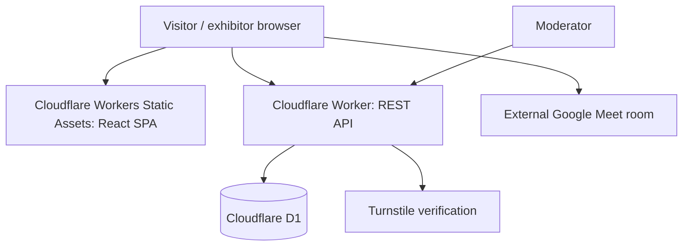

# Proposed system architecture

## Shape

Single deployable app, edge-hosted. Prefer simplicity to separate services.

Google Meet is an outbound link, not a backend dependency. The system does not relay audio or video.

## Stack

- React, Vite, TypeScript, Tailwind for a static client.
- One Cloudflare Worker serving static files and the `/api/*` routes.
- D1 for transactional app state, using parameterized statements.
- Turnstile server-side validation for public submission.
- Optionally Hono for API routing if it speeds implementation; not required.

## Read traffic and caching

- Static assets: immutable, fingerprinted build output.
- Published booth list: short cache or conditional requests; refresh on demand / every 30-60 seconds.
- Individual booth details: read from D1, optional short-lived cache.
- Do not cache user edit tokens or moderator responses.
- Avoid real-time presence and WebSockets in v0.

## Map

An original SVG or responsive image with percentage coordinates in a 0-100 scale. Store booth zone, x, y. Clicking a marker opens a modal; a list is always available as an accessibility fallback.

Do not claim pixel-perfect reproduction of the official event map without a license and reliable source data. A generic virtual hall is the default.

## Public API (initial shape)

| Method | Path | Purpose | Access |
| --- | --- | --- | --- |
| GET | `/api/booths` | List approved booths; search/category/zone filters | Public |
| GET | `/api/booths/:slug` | Approved booth detail | Public |
| POST | `/api/booths` | Request listing; Turnstile + rate limit | Public |
| PATCH | `/api/booths/:id` | Edit own booth | Private capability token |
| PATCH | `/api/admin/booths/:id` | Approve, reject or place booth | Moderator only |

Additional internal/admin read endpoint will be needed for reviewing pending submissions. It must not expose private contact fields to the public endpoint.

## Boundaries

- The Worker validates inputs, authorization, URLs, and status transitions.
- SQL constraints prevent duplicate IDs and invalid status values.
- User-submitted content is rendered as plain text; no arbitrary HTML.
- Registration emails are for ownership verification/communication only, not marketing.

## Deployment

A single staging deployment first. After smoke testing, deploy to an independent domain/subdomain with HTTPS. Keep environment secrets in Cloudflare; never commit credentials.

## Follow-up architecture decisions

See [Decision log](DECISIONS.md) and [ADR 0001](adr/0001-serverless.md).
